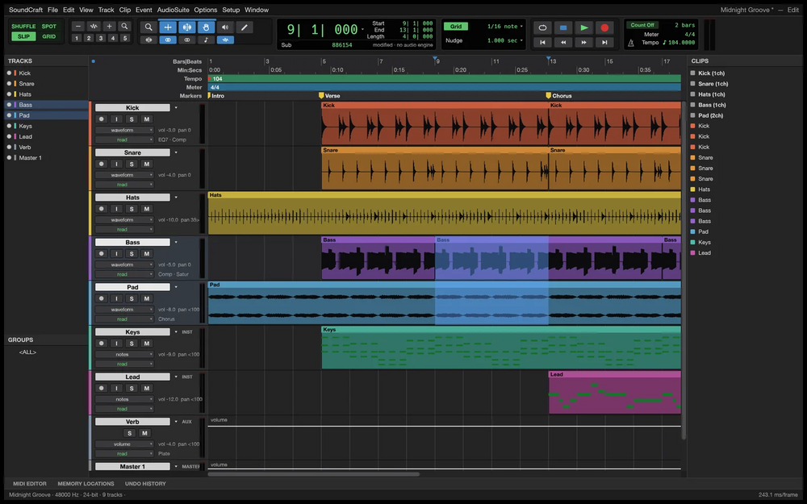

# SoundCraft

Digital audio workstation written in Rust: dedicated Edit and Mix windows, multitrack audio and MIDI, ten inserts and sends per track, surround panning and offline AudioSuite.

## Notes

- From the ArtCraft project.
- Always installs the **latest** release published on GitHub (deb package, amd64).
- Installed with `apt`, so dependencies are resolved automatically. Provides the `soundcraft` and `soundcraft-cli` commands and an application menu entry.
- Re-run **Install** at any time to update to the newest release.

More information on [the project site](https://getartcraft.com/apps/soundcraft) and on [GitHub](https://github.com/storytold/soundcraft).
