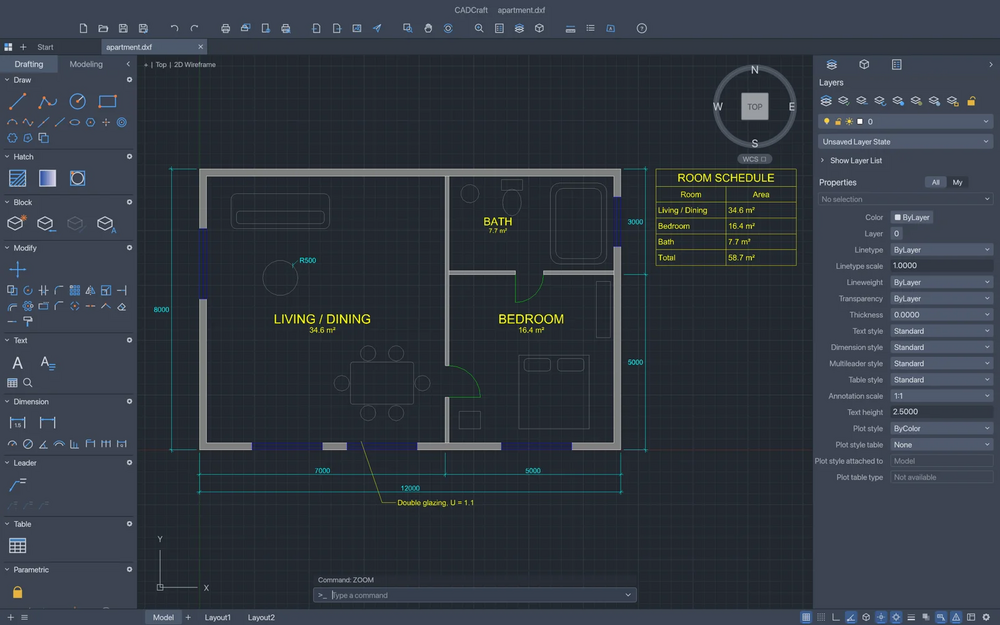

# CadCraft

Computer-aided design and drafting app written in Rust: command line, object snaps, layers, dimensions, hatches, blocks and drawings. Built for both people and AI agents.

## Notes

- From the ArtCraft project.
- Always installs the **latest** release published on GitHub (deb package, amd64).
- Installed with `apt`, so dependencies are resolved automatically. Provides the `cadcraft` and `cadcraft-cli` commands and an application menu entry.
- Re-run **Install** at any time to update to the newest release.

More information on [the project site](https://getartcraft.com/apps/cadcraft) and on [GitHub](https://github.com/storytold/cadcraft).
