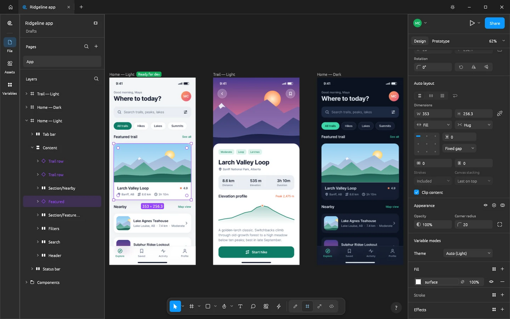

# FigCraft

Interface design app written in pure Rust: frames, auto layout, components and variants, vector networks, styles, variables and prototypes. Opens instantly, works offline, no account and no telemetry.

## Notes

- From the ArtCraft project.
- Always installs the **latest** release published on GitHub (deb package, amd64).
- Installed with `apt`, so dependencies are resolved automatically. Provides the `figcraft` and `figcraft-cli` commands and an application menu entry.
- Re-run **Install** at any time to update to the newest release.

More information on [the project site](https://getartcraft.com/apps/figcraft) and on [GitHub](https://github.com/storytold/figcraft).
