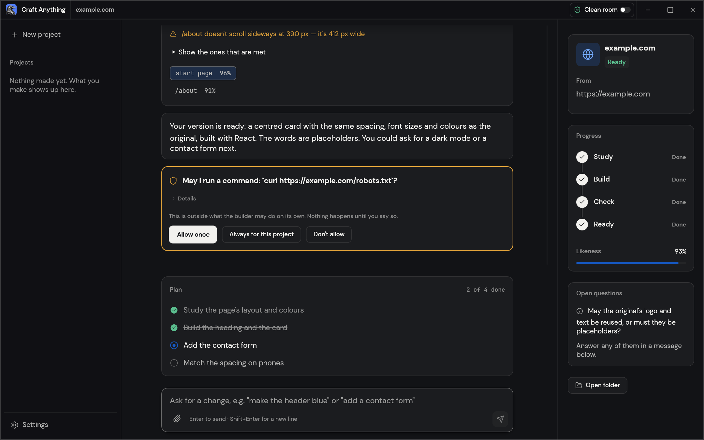

# Craft Anything

Open-source, clean-room engine written in Rust: point it at a website, app or game, say what you want, and it studies the original with real inspection tools, has a coding agent build your own version, then checks the result against the original and refines it.

## Notes

- Installed from the latest `x86_64` deb on GitHub Releases with `apt`, verified with the SHA256 checksums published with the release. `apt` also installs the libraries it needs.
- Early alpha software: expect rough edges.
- Re-run **Install** to update to the latest release.
- Uninstall keeps your projects and settings in your home folder.

More information on [the GitHub page](https://github.com/storytold/craft-anything).
