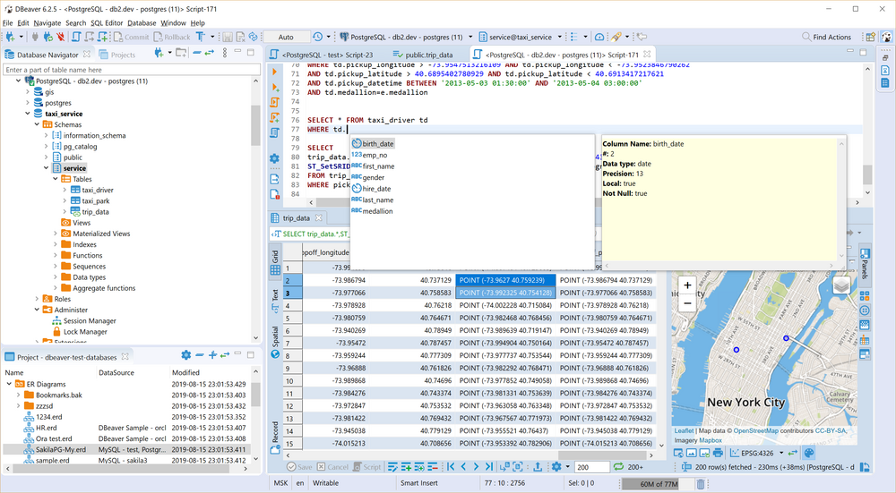

# DBeaver Community

Universal database manager and SQL client for developers and analysts: PostgreSQL, MySQL, SQLite and many more.

## Notes

- Always installs the **latest** Community Edition published on dbeaver.io (deb package, bundles its own Java runtime).
- Installed with `apt`, so dependencies are resolved automatically.
- The project does not publish checksums: the download is verified only by HTTPS.
- Re-run **Install** at any time to update to the newest release.

More information on [the project site](https://dbeaver.io/).
