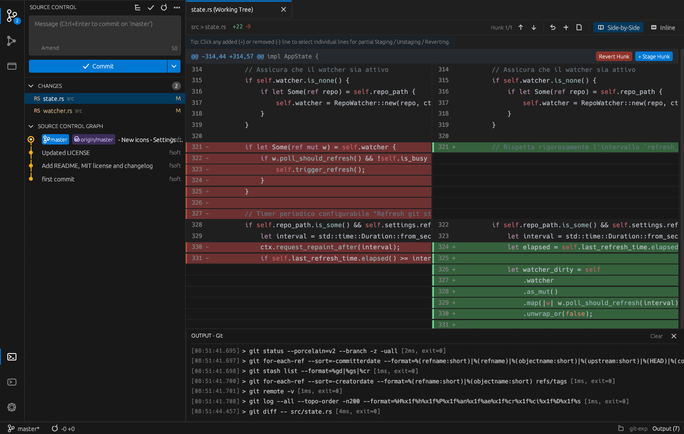

# git-exp

A graphical Git interface inspired by the Source Control view of Visual Studio Code, built in Rust with egui.

## Notes

- Installed from the latest `x86_64` binary on GitHub Releases, verified with the SHA256 checksums published with the release, into `/opt/git-exp`.
- A `git-exp` command and an application menu entry are created.
- The app cannot update itself in `/opt`: re-run **Install** to get the latest version.
- Needs `git` (installed if missing).
- Uninstall keeps your settings in your home folder.

More information on [the GitHub page](https://github.com/fsoft72/git-exp).
