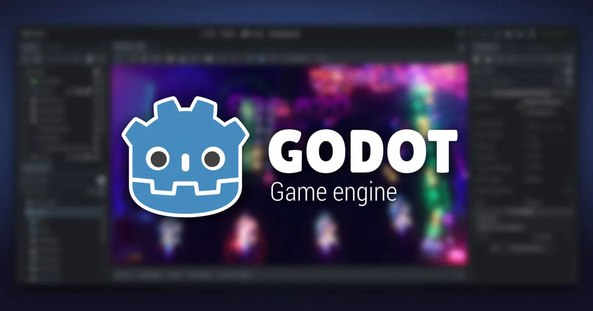

# Godot Engine

Free and open source 2D and 3D game engine. The editor is a single executable, no installer needed.

## Notes

- Always installs the **latest** stable release from GitHub (standard build, not Mono / .NET, Linux x86_64).
- Installed for **your user only**, no system files are touched: the editor in `~/.local/opt/godot`, the `godot` command in `~/.local/bin` and a menu entry in `~/.local/share/applications`.
- Make sure `~/.local/bin` is in your `PATH` to use the `godot` command.
- Re-run **Install** at any time to update to the newest release.

More information on [the project site](https://godotengine.org/).
