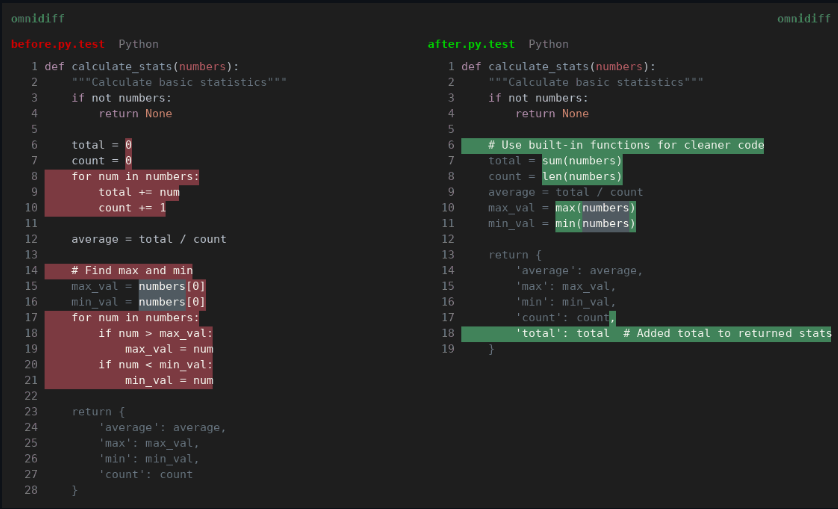

# OmniDiff

Fast, robust, accurate content-aware diffing. Compares code with syntax-aware algorithms, and also pictures, fonts, archives, PDFs and message catalogs, in a two-panel terminal UI.

## Notes

- Installed from the latest static `x86_64` build on GitHub Releases, verified with the SHA256 checksums published with the release, into `/opt/omnidiff`.
- An `omnidiff` command and an application menu entry (opens in a terminal) are created.
- The app cannot update itself in `/opt`: re-run **Install** to get the latest version.
- License: AGPL-3.0-only.

More information on [the GitHub page](https://github.com/ivankovic/omnidiff).
