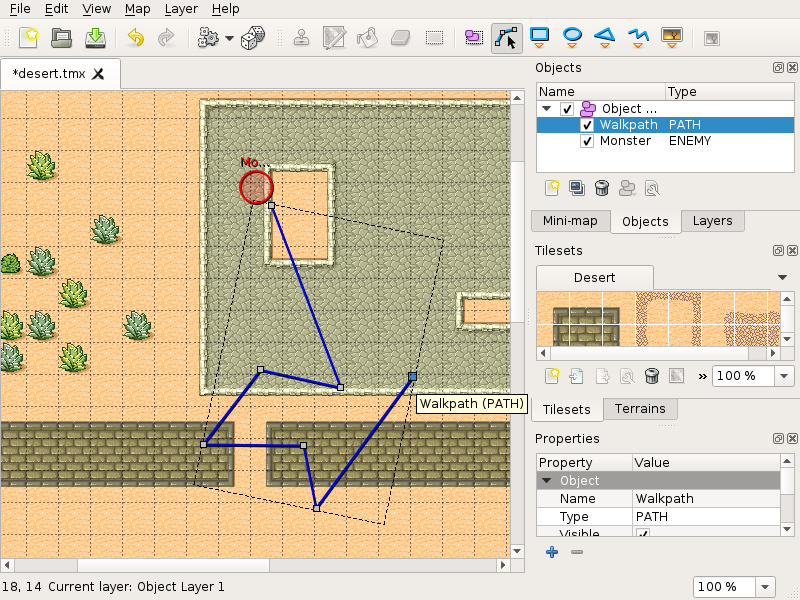

# Tiled

Flexible, general purpose map and level editor for 2D games, with tile layers, objects and terrain tools.

## Notes

- Installed with `apt` from the distribution repositories, so dependencies are resolved automatically.
- The version is the one packaged by your distribution, not necessarily the newest upstream release.
- Re-run **Install** to update the package.

More information on [the project site](https://www.mapeditor.org/).
