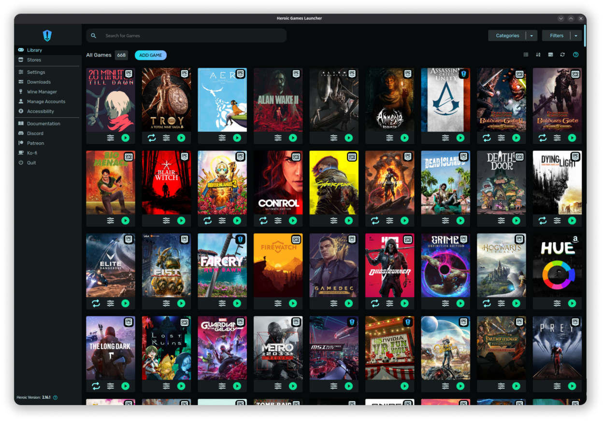

# Heroic Games Launcher

Open source launcher for the Epic Games Store, GOG and Amazon Games, with Wine and Proton support to run Windows games on Linux.

## Notes

- Always installs the **latest** release published on GitHub (deb package, amd64).
- Installed with `apt`, so dependencies are resolved automatically. Provides the `heroic` command and an application menu entry.
- Re-run **Install** at any time to update to the newest release.

More information on [the project site](https://heroicgameslauncher.com/) and on [GitHub](https://github.com/Heroic-Games-Launcher/HeroicGamesLauncher).
