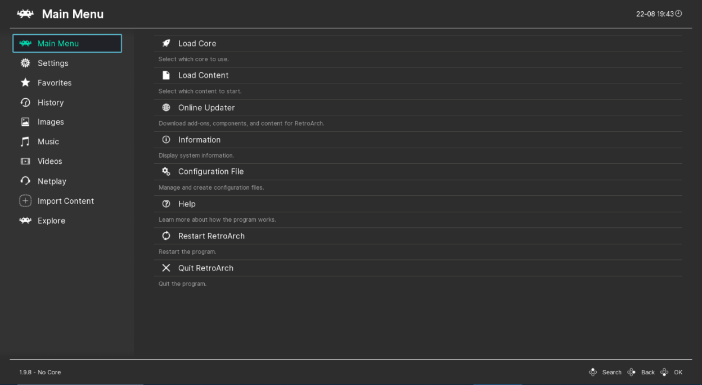

# RetroArch

Frontend for emulators, game engines and media players, built on the libretro API: one interface for thousands of retro games.

## Notes

- Installed with `apt`, never with Snap or Flatpak, so dependencies are resolved automatically.
- On Ubuntu and derivatives the official `ppa:libretro/stable` is added first, as suggested by the RetroArch Linux instructions.
- On Debian the package comes from the distribution repositories.
- Cores are downloaded from inside the program (Online Updater, Core Downloader). Debian may patch the Online Updater out; in that case install cores with `apt` (`libretro-*` packages).
- Re-run **Install** to update the package.

More information on [the project site](https://www.retroarch.com/) and in the [Linux instructions](https://www.retroarch.com/linux-instructions.php).
