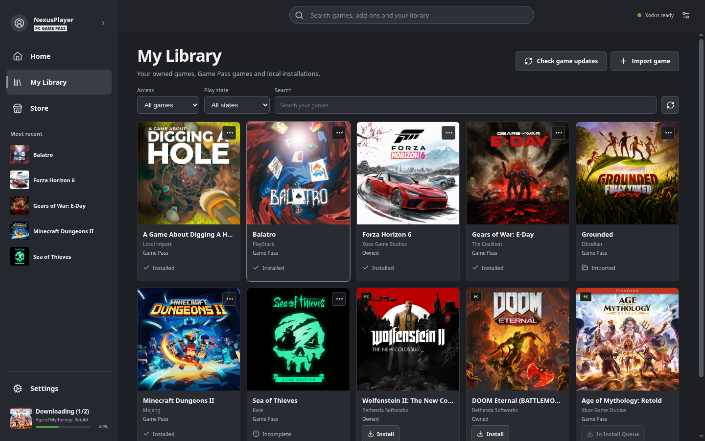

# Xodus Nexus

Open-source Xbox-inspired launcher for your Microsoft Store PC games on Linux: browse the Store, install games you own or get through a subscription, and play them with one shared runtime.

## Notes

- Installed from the latest `x86_64` AppImage on GitHub Releases, verified with its SHA512 checksum, into `/opt/xodus-nexus`.
- The runtime libraries it needs are installed with `apt`; a `xodus-nexus` command and an application menu entry are created.
- On first run open **Settings**, install the **Nexus backend** and the **Nexus runtime**, then sign in with your Microsoft account. A valid game purchase or subscription is required.
- The system keyring (KDE Wallet or GNOME Keyring) must be enabled and unlocked to store the sign-in.
- Independent, unofficial project built on Xodus; report issues in its own repository.
- Re-run **Install** to update the launcher.
- Uninstall keeps your games, settings and sign-in data in your home folder.

More information on [the GitHub page](https://github.com/domsvoboda/xodus-nexus).
