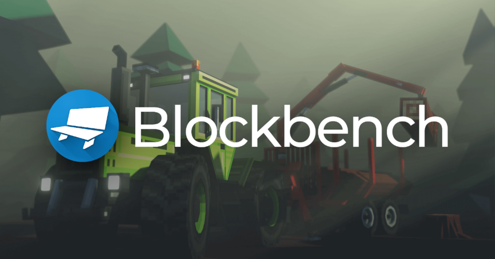

# Blockbench

Free and open source editor for low-poly 3D models and pixel art textures, popular for game and Minecraft content.

## Notes

- Always installs the **latest** release published on GitHub (deb package).
- Installed with `apt`, so dependencies are resolved automatically.
- The project does not publish checksums: the download is verified only by HTTPS.
- Re-run **Install** at any time to update to the newest release.

More information on [the project site](https://www.blockbench.net/) and on [GitHub](https://github.com/JannisX11/blockbench).
