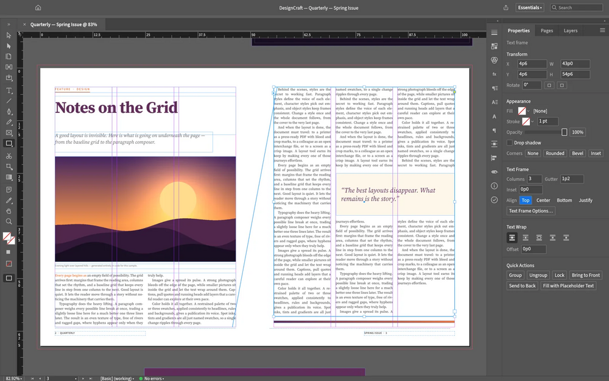

# DesignCraft

Page and layout design editor written in Rust: spreads and parent pages, threaded stories, styles, swatches and text wrap, with a professional paragraph composer. No subscription, no telemetry.

## Notes

- From the ArtCraft project.
- Always installs the **latest** release published on GitHub (deb package, amd64).
- Installed with `apt`, so dependencies are resolved automatically. Provides the `designcraft` and `designcraft-cli` commands and an application menu entry.
- Re-run **Install** at any time to update to the newest release.

More information on [the project site](https://getartcraft.com/apps/designcraft) and on [GitHub](https://github.com/storytold/designcraft).
