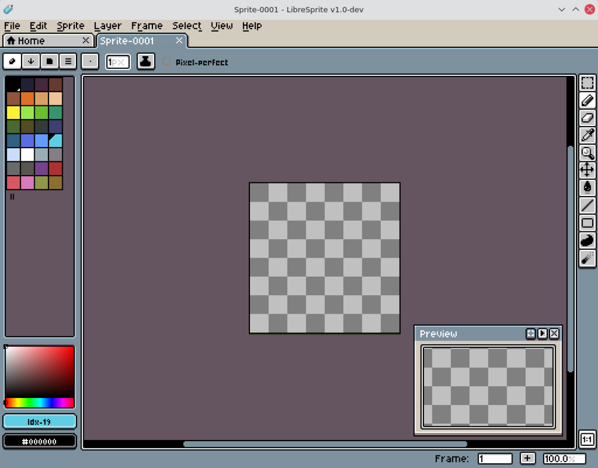

# LibreSprite

Free and open source animated sprite editor and pixel art tool.

## Notes

- Always installs the **latest** release published on GitHub (AppImage, x86_64). There is no deb package.
- Installed for **your user only**: the AppImage in `~/.local/opt/libresprite`, the `libresprite` command in `~/.local/bin` and a menu entry in `~/.local/share/applications`.
- Needs FUSE 2 (`libfuse2`), installed with `apt` when missing.
- The project does not publish checksums: the download is verified only by HTTPS.
- Make sure `~/.local/bin` is in your `PATH` to use the `libresprite` command.
- Re-run **Install** at any time to update to the newest release.

More information on [the project site](https://libresprite.github.io/) and on [GitHub](https://github.com/LibreSprite/LibreSprite).
