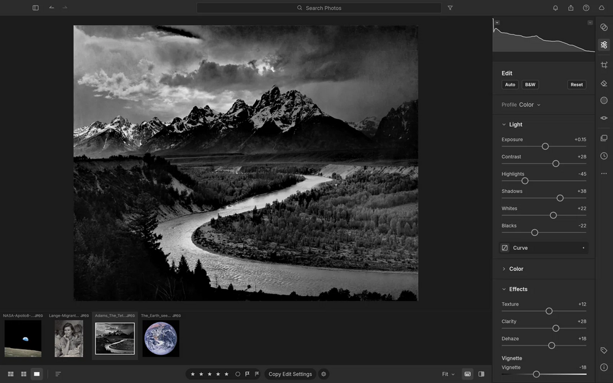

# LightCraft

Fast photo library and non-destructive raw developer, written from scratch in Rust. No account, no cloud, no telemetry, no subscription.

## Notes

- From the ArtCraft project.
- Always installs the **latest** release published on GitHub (deb package, amd64).
- Installed with `apt`, so dependencies are resolved automatically. Provides the `lightcraft` and `lightcraft-cli` commands and an application menu entry.
- Re-run **Install** at any time to update to the newest release.

More information on [the project site](https://getartcraft.com/apps/lightcraft) and on [GitHub](https://github.com/storytold/lightcraft).
