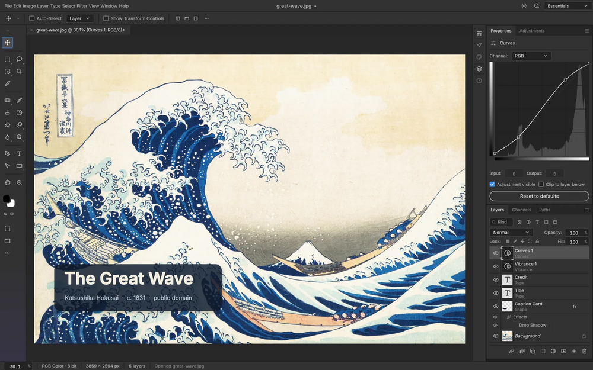

# PhotoCraft

Open source image editor written entirely in Rust: layers, masks, adjustment layers, layer styles, type, vectors and brushes. Works offline.

## Notes

- Early alpha, from the ArtCraft project.
- Always installs the **latest** release published on GitHub (AppImage, x86_64).
- Installed in `/opt/photocraft`, launcher command `photocraft`, plus an application menu entry.
- Re-run **Install** at any time to update to the newest release.

More information on [the project site](https://getartcraft.com/apps/photocraft) and on [GitHub](https://github.com/storytold/photocraft).
