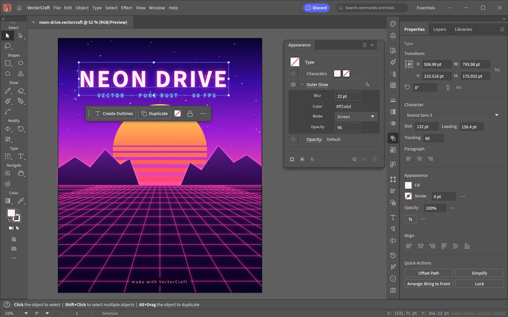

# VectorCraft

Open source vector art tool written in Rust, with the pen, panels and shortcuts working illustrators expect. Also runs in the browser.

## Notes

- Early alpha, from the ArtCraft project.
- Always installs the **latest** release published on GitHub (deb package, amd64).
- Installed with `apt`, so dependencies are resolved automatically. Provides the `vectorcraft` and `vectorcraft-cli` commands and an application menu entry.
- Re-run **Install** at any time to update to the newest release.

More information on [the project site](https://getartcraft.com/apps/vectorcraft) and on [GitHub](https://github.com/storytold/vectorcraft).
