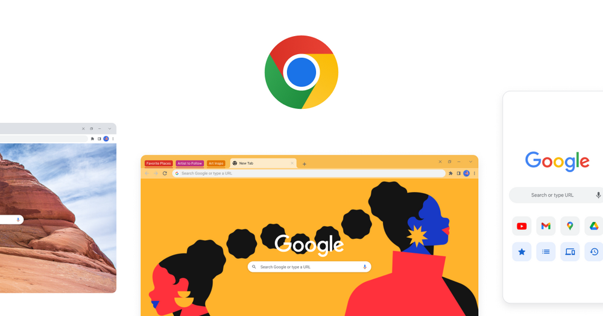

# Google Chrome

Fast, secure web browser from Google (stable channel).

## Notes

- Always installs the **latest stable** build published by Google (deb package, amd64).
- The deb adds Google's apt repository, so later updates arrive with the normal system updates.
- Re-run **Install** at any time to update immediately.

More information on [the project site](https://www.google.com/chrome/).
