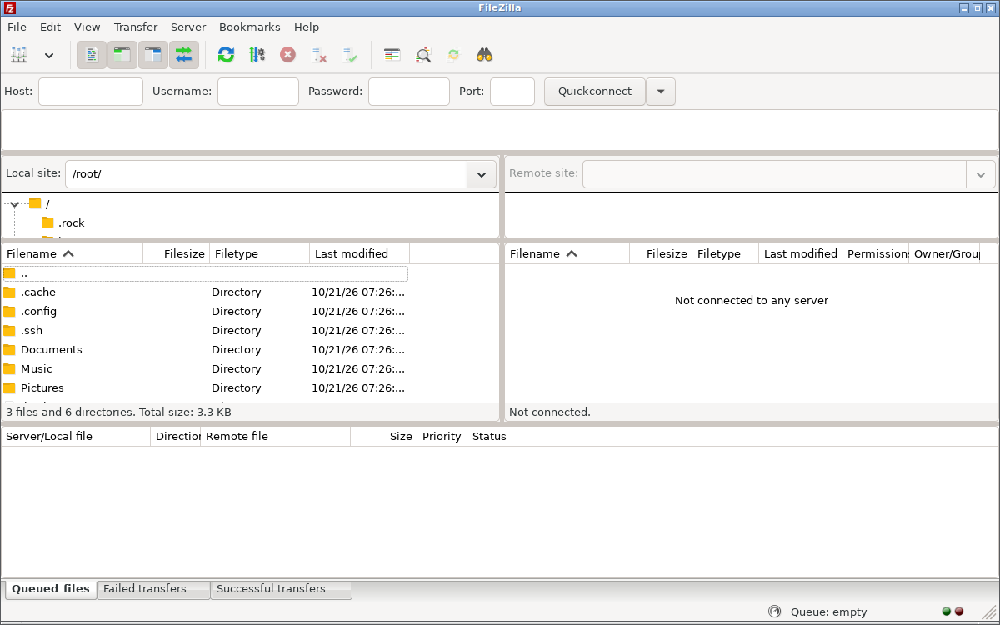

# FileZilla

Free, open-source FTP, FTPS and SFTP client: browse local and remote folders side by side, transfer files with a queue, resume interrupted transfers and keep your servers in the Site Manager.

## Notes

- Installed from the distribution repositories with `apt`, so it is updated together with the system.
- Connect with the Quickconnect bar (host, username, password, port) or save the server in the Site Manager (`Ctrl+S`).
- For SFTP, choose the `sftp://` protocol or use a key file in **Edit > Settings > Connection > SFTP**.
- Uninstall keeps your saved sites and settings in `~/.config/filezilla`.

More information on [the home page](https://filezilla-project.org/).
