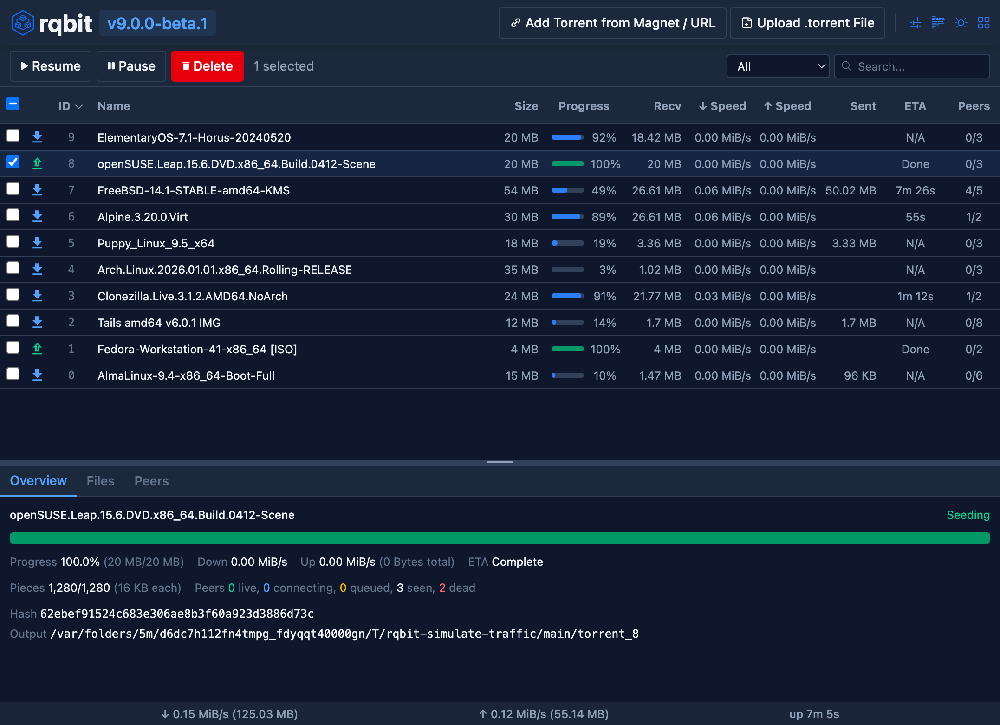

# rqbit

Fast, lightweight BitTorrent client written in Rust: add torrents from a file, a magnet link or a URL, choose which files to download, stream media while it downloads and keep everything in one small desktop window.

## Notes

- Installed from the latest `amd64` desktop deb on GitHub Releases with `apt`, which also installs the libraries it needs.
- Add a torrent with the **+** button: paste a magnet link, pick a `.torrent` file or give a URL, then select the files you want.
- Re-run **Install** to update to the latest release.
- Uninstall keeps your settings and the downloaded files.

More information on [the GitHub page](https://github.com/ikatson/rqbit).
