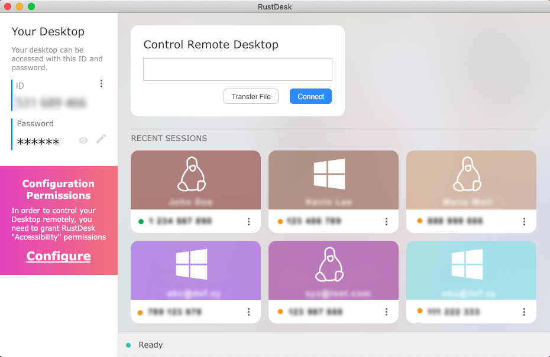

# RustDesk

Open-source remote desktop, a self-hostable alternative to TeamViewer: control another computer, receive support, transfer files and tunnel TCP ports. It works out of the box with the public servers, or with your own.

## Notes

- Installed from the latest `x86_64` deb on GitHub Releases with `apt`, which also installs the libraries it needs.
- The deb registers a `rustdesk` systemd service (needed to be reachable from other computers) and an application menu entry.
- To receive connections, share the ID and password shown in the main window. To control this computer on Wayland, grant the screen sharing permission when asked.
- Re-run **Install** to update to the latest release.
- Uninstall keeps your settings and the ID in your home folder.

More information on [the GitHub page](https://github.com/rustdesk/rustdesk) and the [home page](https://rustdesk.com).
