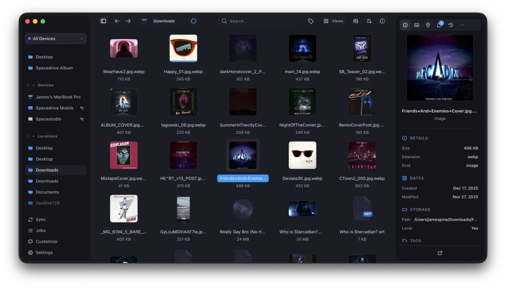

# Spacedrive

Open-source cross-platform file explorer powered by a virtual distributed filesystem: browse and search the files of all your devices and drives in one place, tag them, find duplicates and preview media without moving anything.

## Notes

- Installed from the newest `v2` `x86_64` deb on GitHub Releases with `apt`, which also installs the libraries it needs. v2 is still an alpha pre-release: the 0.4.x stable build needs ffmpeg 7, which Ubuntu 26.04 does not ship. Nightly builds are not used.
- Add a folder or a drive as a **Location** and Spacedrive indexes it in the background; your files are never moved or modified.
- Re-run **Install** to update to the newest v2 release.
- Uninstall keeps your libraries and settings in your home folder.

More information on [the GitHub page](https://github.com/spacedriveapp/spacedrive) and the [home page](https://spacedrive.com).
