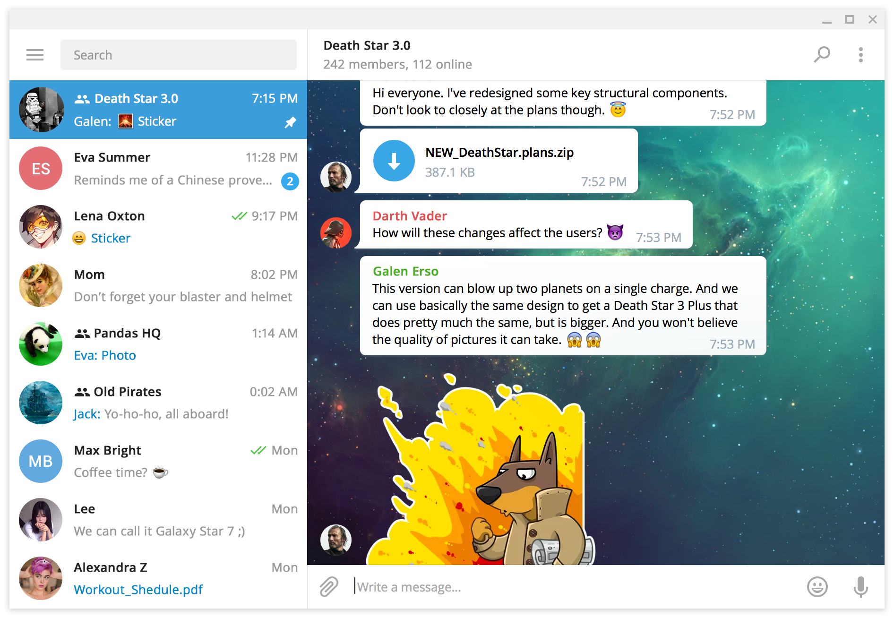

# Telegram Desktop

The official desktop client of the Telegram messenger: chats, groups, channels, calls, voice and video messages, stickers and file sharing up to 2 GB, synced with your phone.

## Notes

- Installed from the latest `x86_64` archive on GitHub Releases, verified with the SHA256 checksum published by GitHub, into `/opt/telegram-desktop`.
- A `telegram-desktop` command and an application menu entry are created; `tg://` links open in it.
- The app cannot update itself in `/opt`: re-run **Install** to get the latest version.
- Sign in by scanning the QR code with your phone or with your phone number.
- Uninstall keeps your accounts and data in your home folder.

More information on [the GitHub page](https://github.com/telegramdesktop/tdesktop) and the [home page](https://desktop.telegram.org).
