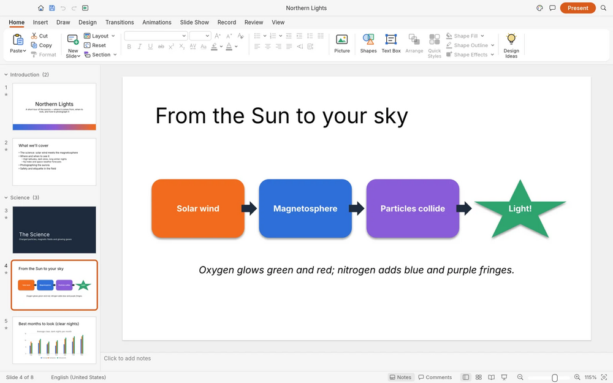

# DeckCraft

Presentation app written in Rust: slide masters, themes, 150+ vector shapes, transitions, animations and presenter view. Opens and saves presentation files. No subscription, no cloud.

## Notes

- From the ArtCraft project.
- Always installs the **latest** release published on GitHub (deb package, amd64).
- Installed with `apt`, so dependencies are resolved automatically. Provides the `deckcraft` and `deckcraft-cli` commands and an application menu entry.
- Re-run **Install** at any time to update to the newest release.

More information on [the project site](https://getartcraft.com/apps/deckcraft) and on [GitHub](https://github.com/storytold/deckcraft).
