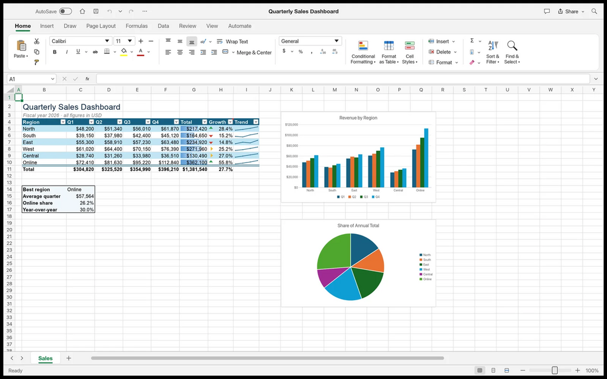

# GridCraft

Spreadsheet app written in Rust: ribbon tabs, formula bar, 500+ calculation functions, dynamic arrays, PivotTables and charts. Reads and writes .xlsx files.

## Notes

- From the ArtCraft project.
- Always installs the **latest** release published on GitHub (deb package, amd64).
- Installed with `apt`, so dependencies are resolved automatically. Provides the `gridcraft` and `gridcraft-cli` commands and an application menu entry.
- Re-run **Install** at any time to update to the newest release.

More information on [the project site](https://getartcraft.com/apps/gridcraft) and on [GitHub](https://github.com/storytold/gridcraft).
