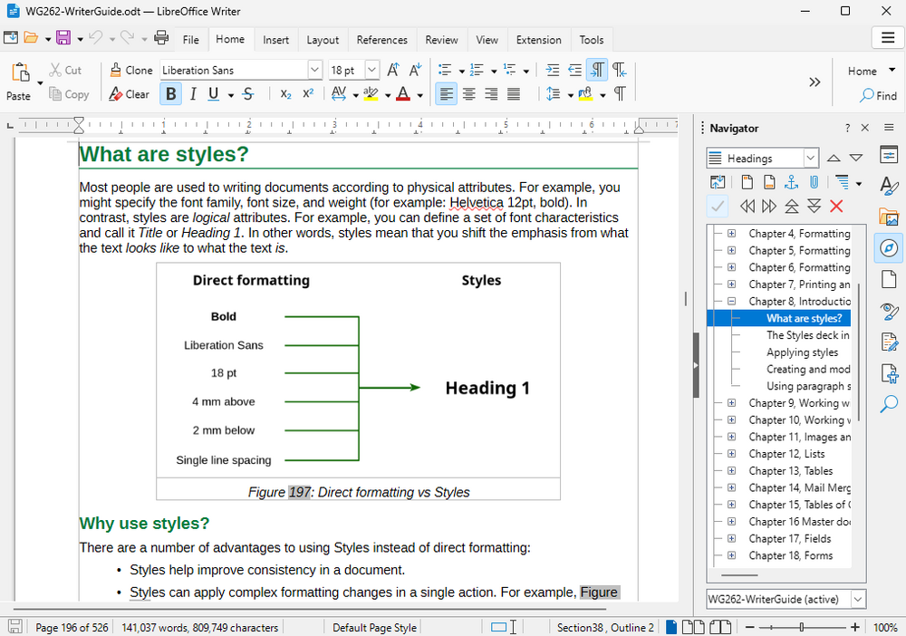

# LibreOffice

Free and open source office suite: Writer (documents), Calc (spreadsheets), Impress (presentations), Draw, Base and Math. Reads and writes `.docx`, `.xlsx`, `.pptx` and the OpenDocument formats.

## Notes

- Always installs the **latest stable** release from The Document Foundation (official deb packages, amd64), checksum verified. It is usually newer than the version in the Ubuntu repositories.
- The language pack of your system language is installed too, when one exists.
- Each minor release (for example 26.2, 26.8) installs in its own folder next to the older ones, so re-running **Install** after a new minor release adds the new one and keeps the old.
- **Uninstall** removes every LibreOffice release installed from the official packages.
- Download size: about 220 MB.

More information on [the project site](https://www.libreoffice.org/).
