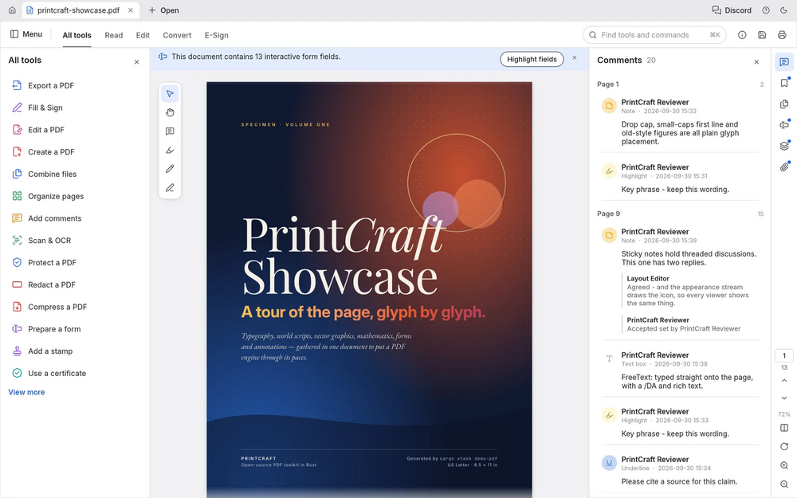

# PdfCraft

Read, organize, combine, split and secure PDFs in a fast native app written in Rust. No account, no telemetry, no cloud.

## Notes

- From the ArtCraft project.
- Always installs the **latest** release published on GitHub (deb package, amd64).
- Installed with `apt`, so dependencies are resolved automatically. Provides the `pdfcraft` and `pdfcraft-cli` commands and an application menu entry.
- Re-run **Install** at any time to update to the newest release.

More information on [the project site](https://getartcraft.com/apps/pdfcraft) and on [GitHub](https://github.com/storytold/pdfcraft).
