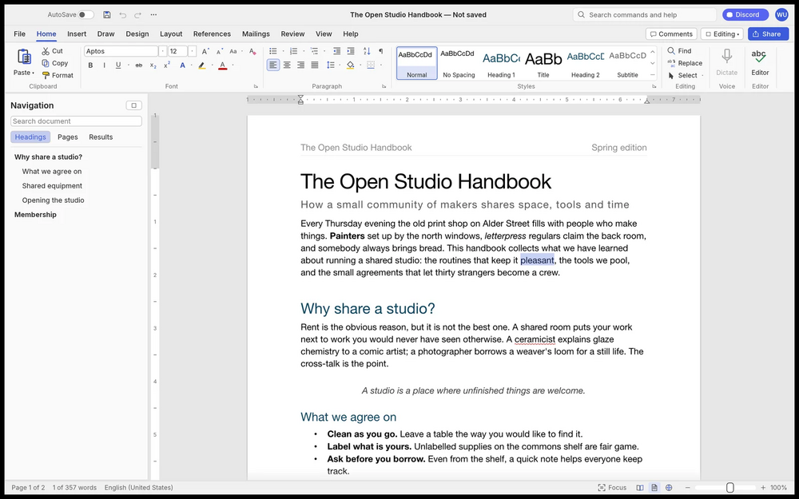

# WordCraft

Word processor written in Rust: ribbon, styles, tables, track changes, references and mail merge. Reads and writes .docx. Open source and offline.

## Notes

- From the ArtCraft project.
- Always installs the **latest** release published on GitHub (deb package, amd64).
- Installed with `apt`, so dependencies are resolved automatically. Provides the `wordcraft` and `wordcraft-cli` commands and an application menu entry.
- Re-run **Install** at any time to update to the newest release.

More information on [the project site](https://getartcraft.com/apps/wordcraft) and on [GitHub](https://github.com/storytold/wordcraft).
