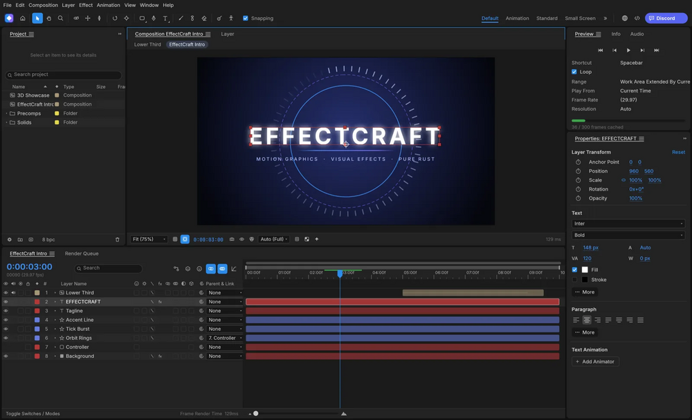

# EffectCraft

Motion graphics and compositing tool written in Rust: compositions, layers, keyframes, 259 effects, expressions, 3D cameras and lights, and a render queue.

## Notes

- From the ArtCraft project.
- Always installs the **latest** release published on GitHub (deb package, amd64).
- Installed with `apt`, so dependencies are resolved automatically. Provides the `effectcraft` and `effectcraft-cli` commands and an application menu entry.
- Re-run **Install** at any time to update to the newest release.

More information on [the project site](https://getartcraft.com/apps/effectcraft) and on [GitHub](https://github.com/storytold/effectcraft).
