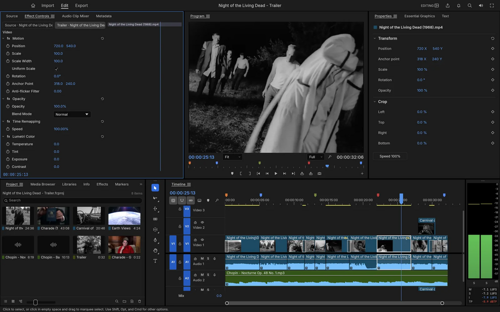

# FilmCraft

Open source nonlinear video editor written in Rust: source and program monitors, a real timeline and every trim mode, with its own codecs.

## Notes

- From the ArtCraft project.
- Always installs the **latest** release published on GitHub (deb package, amd64).
- Installed with `apt`, so dependencies are resolved automatically. Provides the `filmcraft` and `filmcraft-cli` commands and an application menu entry.
- Re-run **Install** at any time to update to the newest release.

More information on [the project site](https://getartcraft.com/apps/filmcraft) and on [GitHub](https://github.com/storytold/filmcraft).
