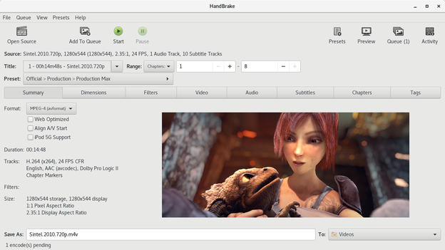

# HandBrake

Open source video transcoder with a graphical interface, for converting video from almost any format.

## Notes

- Installed with `apt` from the distribution repositories, so dependencies are resolved automatically.
- The version is the one packaged by your distribution, not necessarily the newest upstream release.
- Re-run **Install** to update the package.

More information on [the project site](https://handbrake.fr/).
