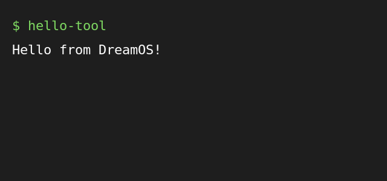

# Hello Tool

A tiny demo command line tool that prints a greeting.

This is an **example** app for `dreamos-install`. Installing it only
creates a marker file under `/tmp/dreamos-install-demo`, so it is safe
to try on any machine.

## What you get

- a greeting
- an uninstall script
  - so you can try the *Uninstall* button too
