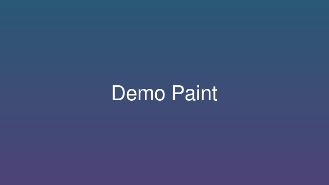

# Demo Paint

A pretend painting program, used to show how descriptions are rendered.



## Features

1. Brushes, layers and filters
2. Coloured terminal output during install
3. A remote image that is not loaded:


The install runs commands like:

```
apt-get install -y demo-paint
```

More information on [the project site](https://example.com).

---

*This app has no uninstall script.*
